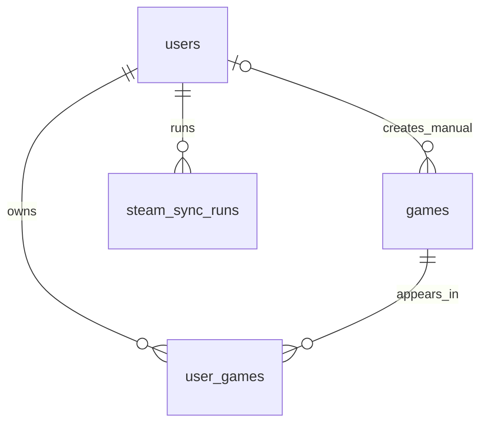

# Система учёта коллекции игр

Курсовой проект по теме «Серверная часть системы учета коллекции игр пользователя и статистики прохождения».

**[Открыть демоколлекцию Savepoint](https://mystery1322.github.io/game-collection-tracker/)**. В демоверсии шесть примеров игр. Изменения сохраняются в браузере посетителя. Оставьте подсказку «В следующий раз», обновите страницу, затем нажмите «Готово».

**[Локальное приложение](http://localhost:3000/)** работает после запуска Node.js. Войдите или создайте аккаунт и добавьте свою игру. Карточка хранит оценку, статус, минуты, заметку и отдельную подсказку до 240 символов. Кнопка «Готово» очищает подсказку. Данные аккаунта сохраняются в PostgreSQL.

17 ноября 2026 года база `game_collection` создана в локальном PostgreSQL 18.7, миграция применена, все 14 SQL-проверок выполнены успешно. Пять таблиц и представление статистики доступны; тестовые строки отменены, таблицы пусты. Итоговая проверка сохранена в `db/01_inspect_database.sql`, протокол — в `db/verification.md`.

18 ноября 2026 года сервер запущен на рабочей базе под ролью `game_collection_app`. 20 ноября применена миграция `002_next_step.sql` и подключён интерфейс коллекции. В локальном приложении кнопка «Обновить из Steam» запускает импорт через API. Проверка реальной библиотеки остаётся отдельным этапом.

## Запуск сервера

На новой базе выполните миграции из `db/migrations/` по порядку: 001, 002, 003. На существующей базе под её владельцем выполните только ещё не применённые миграции. Исходные файлы экрана находятся в `public/`. Локальный деморежим открывается по адресу `http://localhost:3000/?demo=1`. GitHub Pages раздаёт содержимое `public/` из корня ветки `gh-pages`; после коммита изменений экрана обновите её командой `git subtree push --prefix=public origin gh-pages`.

На настроенном компьютере откройте терминал в папке `Проект` и выполните:

```powershell
node --env-file=.env src/server.js
```

Проверка в браузере — [состояние API](http://localhost:3000/api/health). При доступной БД ответ имеет вид `{"status":"ok"}`. Сервер слушает только локальный адрес. Для остановки в терминале нажмите Ctrl+C. Если сервер уже запущен, сразу откройте адрес проверки.

Для новой установки нужны Node.js 24, pnpm (проверена версия 11.25.0) и PostgreSQL 18. Выполните шаги подготовки базы ниже, затем в папке проекта:

```powershell
pnpm install --frozen-lockfile
node scripts/setup-local.js
```

Скрипт создаёт локальный `.env` со случайными секретами и `tmp/setup-role.sql`. Выполните сгенерированный SQL целиком в DBeaver в базе `game_collection` от имени её администратора. Он создаёт отдельную роль и выдаёт доступ к объектам приложения. На рабочем компьютере этот шаг уже выполнен. Через `node --env-file=.env src/server.js` можно запускать сервер после каждого перезапуска компьютера. Имена настроек приведены в `.env.example`. Файл `.env` и каталог `tmp` исключены из Git.

Для реального импорта заполните `STEAM_API_KEY` в локальном `.env` и перезапустите сервер. Регистрация, ручные игры и статистика работают при пустом ключе.

После успешного импорта первой показывается последняя запущенная игра. Сервер читает необязательное поле Steam `rtime_last_played` и сохраняет дату в личной записи. Игры с неизвестной датой остаются внизу. Следующий импорт сохраняет последнюю известную дату, если Steam вернул ноль или пропустил поле. Выбранная вручную сортировка запоминается в этом браузере отдельно для каждого аккаунта. В демоколлекции показаны примерные даты.

## HTTP API

Тело запроса и ответ передаются в JSON. Регистрация сразу открывает сеанс. Браузер передаёт cookie `collection.sid` при последующих запросах на тот же адрес. Все маршруты коллекции, статистики и Steam требуют входа. Успешное удаление и выход возвращают HTTP 204. Ошибки имеют форму `{"error":{"code":"…","message":"…"}}`.

| Метод и путь | Входные данные и результат |
| --- | --- |
| POST `/api/auth/register` | `email`, `displayName` (1–80 символов), `password` (8–128 символов). Возвращает профиль и HTTP 201 |
| POST `/api/auth/login` | `email`, `password`. Возвращает профиль и устанавливает новый сеанс |
| GET `/api/auth/me` · POST `/api/auth/logout` | Текущий профиль и завершение сеанса |
| POST `/api/collection` | Обязательное `title`, при желании личные поля. Возвращает карточку и HTTP 201 |
| GET `/api/collection` | `q`, `status`, `sort=title/time/rating/recent`, `direction=asc/desc`, `page`, `pageSize` (до 100). Ответ содержит `items`, `total`, `page`, `pageSize` |
| GET · PATCH · DELETE `/api/collection/:id` | Чтение, частичное изменение и удаление. Используется ID записи коллекции. Для чужой игры — HTTP 404 |
| GET `/api/statistics` | `totalGames`, `byStatus`, `totalPlaytimeMinutes`, `averageRating`, `completionPercent` и до пяти игр в `topGames` |
| PUT `/api/steam/source` | `steamId` строкой из 17 цифр. Первый успешный импорт закрепляет источник |
| POST `/api/steam/sync` | Запускает импорт сразу. В результате есть `addedCount` и `updatedCount`; между попытками должна пройти минута |
| GET `/api/steam/sync-status` | Источник, последняя попытка и время последнего успеха |

Пример тела ручного добавления:

```json
{"title":"Portal","status":"completed","playtimeMinutes":180,"rating":9,"notes":"Прошёл основную кампанию","completedAt":"2026-11-01"}
```

Допустимые статусы — `planned`, `playing`, `completed`, `paused`, `dropped`. Для снятия оценки передайте `rating: null`. Время импортированной игры обновляет Steam. Удалённая из коллекции Steam-игра может появиться при следующем импорте.

## Подготовка базы

Используется PostgreSQL 18.7. В DBeaver уже настроено административное подключение к `localhost:5432`, базе `postgres`, пользователю `postgres`. Пароль остаётся локальным и в файлы проекта не включается.

1. Через административное подключение выполнить `db/00_create_database.sql` один раз. Для `CREATE DATABASE` нужен режим autocommit, без оборачивания в транзакцию. Если база уже существует, не удалять её, а проверить текущую структуру.
2. Открыть отдельное подключение или SQL-редактор именно для базы `game_collection`. В конфигурации подключения DBeaver включить «Показать все базы данных»; после переподключения выбрать `public@game_collection` через «Database/Schema» в верхней панели SQL-редактора. На рабочем компьютере это уже настроено.
3. Выполнить целиком `db/migrations/001_initial_schema.sql`. В DBeaver используется команда выполнения скрипта, а не только текущего оператора. Миграция содержит собственную транзакцию и проверку имени базы; выполняется один раз. При ошибке выполнить `ROLLBACK` и проверить причину, прежде чем повторять запуск.
4. Выполнить целиком `db/tests/001_schema_checks.sql` и проверить сообщение `PASS: 14 ...`. Тестовые строки откатываются. Последовательности идентификаторов могут иметь пропуски после проверки — это нормальная работа PostgreSQL.

Проверить объекты можно запросом:

```sql
SELECT table_name, table_type
FROM information_schema.tables
WHERE table_schema = 'public'
ORDER BY table_type, table_name;
```

Ожидаются пять таблиц и представление `user_statistics`. В рабочей базе сервер подключается под отдельной ролью `game_collection_app`.

## Структура данных

| Объект | Назначение |
| --- | --- |
| `users` | Аккаунты приложения, хеши паролей и источник импорта Steam |
| `games` | Общие сведения об играх Steam и вручную добавленные игры |
| `user_games` | Коллекция пользователя: статус, часы, оценка, заметка и дата завершения |
| `sessions` | Серверные сессии, структура для `connect-pg-simple` с `tableName: 'sessions'` |
| `steam_sync_runs` | Попытки импорта, их результат и число обработанных игр |
| `user_statistics` | Рассчитываемая статистика по текущей коллекции каждого пользователя |



Одна игра Steam хранится в `games` один раз. Разные пользователи могут иметь разные статусы и оценки одной игры. Ручная игра принадлежит создавшему её пользователю. `sessions` хранит сериализованные данные сеанса, а не прямой внешний ключ на пользователя.

Время хранится целыми минутами. SteamID64 — строкой из 17 цифр, Steam AppID — положительным `bigint` в диапазоне uint32. Служебные даты хранятся как `timestamptz`, календарная дата завершения — как `date`. Ограничения проверяют статусы, время, оценку, уникальность email без учёта регистра и отсутствие повторов в коллекции.

Триггер перед сохранением проверяет владельца ручной игры, отклоняет дату завершения в будущем, очищает её при смене статуса и обновляет `updated_at`. Это не заменяет проверку прав в серверных маршрутах: приложение должно ограничивать каждую выборку и изменение текущим пользователем.

Представление возвращает количество игр по статусам, минуты, среднюю оценку среди оценённых игр и долю пройденных. Для пустой коллекции числа равны нулю, средняя оценка — NULL. Сервер дополняет результат пятью играми с наибольшим положительным временем.

У пользователя одновременно допускается одна запись импорта со статусом `running`. Сервис завершает её статусом `success` или `failed`. При следующем обращении к импорту, источнику или его состоянию незавершённая попытка старше двух минут помечается прерванной. Названия, значки и минуты обновляются в одной транзакции. Статус, оценка, заметка и дата прохождения сохраняются.

## Проверки

SQL-проверки описаны в `db/verification.md`. Для HTTP-проверок запустите `node --test tests/api.test.js`. Тест создаёт временный экземпляр PostgreSQL на свободном локальном порту, применяет миграцию и выдаёт роли те же права, что и в основной базе. После прогона экземпляр останавливается. По умолчанию в Windows утилиты берутся из `C:/Program Files/PostgreSQL/18/bin`. Для другого пути задайте переменную `PG_BIN`.

18 ноября прошли все 10 сценариев HTTP. Среди них изоляция двух аккаунтов, повторный вход, проверка полей, пересчёт статистики после удаления, повторный и параллельный импорт, неполный ответ, тайм-аут и откат при ошибке записи. При тесте отката ожидается запись в журнале с кодом PostgreSQL 23514. Сеть Steam в тестах заменена локальными ответами. На основной базе отдельно проверен `GET /api/health`.

## Технические источники

- [PostgreSQL 18 — CREATE DATABASE](https://www.postgresql.org/docs/18/sql-createdatabase.html).
- [PostgreSQL 18 — ограничения данных](https://www.postgresql.org/docs/18/ddl-constraints.html).
- [connect-pg-simple — схема таблицы сессий](https://github.com/voxpelli/node-connect-pg-simple/blob/HEAD/table.sql).
- [Express — параметры сеансов и cookie](https://expressjs.com/en/resources/middleware/session/).
- [node-postgres — транзакции на одном подключении](https://node-postgres.com/features/transactions).
- [Steamworks — передача ключа Web API](https://partner.steamgames.com/doc/webapi_overview/auth).
